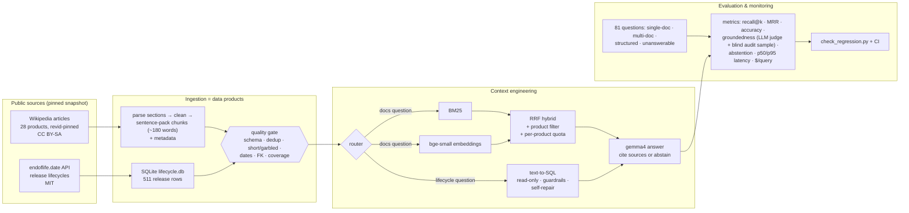

# Grounded Q&A over Enterprise Product Data
### a context-engineering and evaluation pipeline

**In plain English:** IT teams ask questions like *"When does RHEL 9 maintenance support end?"*,
*"What license does Proxmox VE use?"* or *"Which ESXi versions went out of support in 2022?"*.
The answers live in two places: prose documentation (unstructured) and lifecycle tables (structured).
This project turns both into documented, quality-checked **data products**. It then gives an LLM the right
context for each question (keyword search, semantic search, hybrid search, metadata filters, or a SQL
lookup) and **measures** how well each strategy works: whether the right sources were found,
whether the answer is correct, whether every claim is backed by a source, whether the system
says "I don't know" when it should, and how fast and how expensive each answer is. A regression
check (`scripts/check_regression.py`) fails if a tracked metric drops past its tolerance. CI runs
the data-quality gate and the retrieval metrics on every push. Answer, groundedness, and latency
metrics need the local LLM, so they are checked by the same script after a local run.

Everything runs locally (open-source embedding model, `gemma4` 8B as the generator and `qwen3:8b` as
the judge via Ollama), so the API cost is $0. The judge comes from a different model family than the generator, so the generator is never grading its own answers.

## Results (all numbers from `reports/metrics.json`, produced by `scripts/run_full_eval.sh`)

**Setup.** 81 questions: 29 single-doc, 16 multi-doc, 20 structured (lifecycle/SQL), and 16 unanswerable.
Generator: `gemma4` 8B (Q4) on an M3 MacBook Air with 16 GB. Judge: `qwen3:8b`. Top-k = 5. Retrieval
metrics use the 45 text questions that have gold evidence.

### Headline
- **Routing lifecycle questions to text-to-SQL is the biggest win.** Accuracy rises from **74.1% to 91.4%**,
  +17.3 points vs. the best text-only config (paired bootstrap 95% CI [+9.9, +25.9]). Structured accuracy rises from
  10% to 75%, and the share of answerable questions the system wrongly refused drops from 12.3% to 3.1%.
  The SQL path is also cheaper: SQL-routed questions average 906 input tokens, vs. 1,284 for the docs path.
- **Hybrid + metadata filter retrieves best:** recall@5 **0.933** vs. 0.844 for BM25, +8.9 points (CI [+2.2, +16.7]).
  Plain hybrid (0.911) is also significantly better than BM25. Dense alone (0.867) is *not* distinguishable
  from BM25 on this corpus.
- **Hybrid vs. hybrid + filter makes no difference to answer accuracy** (74.1% both). The filter's retrieval gain
  shows up in recall, not in final answers, at n=81.
- **Abstention:** 100% correct abstention on the 16 unanswerable questions for `routed`. **Groundedness:** the
  LLM judge finds 99.2% of claims supported by the retrieved context. A blind audit of 30 answers puts the
  fully-grounded rate at 90%, because the judge is too lenient on SQL-column misreadings (see "judge reliability").
- **Latency:** routed p50 7.0 s, p95 14.2 s, almost all of it LLM time. Retrieval is 1–15 ms.
  **Cost:** $0 API; about $0.00001 of electricity per query. The same token counts on a hosted model priced
  at $1/$5 per M input/output tokens would cost $0.0014 per query (the price is a config input, not a quote).

### Retrieval (45 questions with gold evidence; each k scored on its own `search(k)` list)
| Retriever | R@1 | R@5 | R@10 | MRR@10 | All evid.@5 | Multi-doc R@5 | p50 ms |
|---|---:|---:|---:|---:|---:|---:|---:|
| `bm25` | 0.533 | 0.844 | 0.889 | 0.760 | 0.756 | 0.750 | 0.9 |
| `dense` | 0.511 | 0.867 | 0.956 | 0.736 | 0.800 | 0.812 | 13.2 |
| `hybrid` | 0.589 | 0.911 | 0.978 | 0.795 | 0.867 | 0.875 | 14.6 |
| `hybrid_meta_hard` | 0.589 | 0.911 | 0.944 | 0.803 | 0.867 | 0.875 | 15.3 |
| `hybrid_meta` | 0.600 | 0.933 | 0.967 | 0.805 | 0.889 | 0.875 | 14.5 |

### End-to-end answers (81 questions)
| Config | Answer acc. | Judge acc. | Groundedness | Abstain (unans.) | False abstain | p50 s | p95 s | In tok | Hosted $/q |
|---|---:|---:|---:|---:|---:|---:|---:|---:|---:|
| `bm25` | 70.4% | 73.6% | 97.4% | 100.0% | 18.5% | 11.2 | 17.1 | 1376 | $0.00157 |
| `dense` | 69.1% | 71.4% | 97.9% | 93.8% | 13.9% | 10.3 | 17.3 | 1306 | $0.00150 |
| `hybrid` | 74.1% | 78.6% | 99.0% | 93.8% | 13.9% | 8.9 | 19.9 | 1322 | $0.00153 |
| `hybrid_meta` | 74.1% | 75.4% | 99.1% | 93.8% | 12.3% | 7.5 | 13.9 | 1330 | $0.00154 |
| `routed` | 91.4% | 92.1% | 99.2% | 100.0% | 3.1% | 7.0 | 14.2 | 1176 | $0.00141 |

### Accuracy by question type
| Config | single_doc (n=29) | multi_doc (n=16) | structured (n=20) | unanswerable (n=16) |
|---|---:|---:|---:|---:|
| `bm25` | 93.1% | 81.2% | 5.0% | 100.0% |
| `dense` | 93.1% | 81.2% | 5.0% | 93.8% |
| `hybrid` | 96.5% | 93.8% | 10.0% | 93.8% |
| `hybrid_meta` | 96.5% | 93.8% | 10.0% | 93.8% |
| `routed` | 96.5% | 93.8% | 75.0% | 100.0% |

### Is the difference real? (paired bootstrap, 10k resamples)
| retrieval_recall@5_vs_bm25 | diff | 95% CI | n | distinguishable from noise? |
|---|---:|---:|---:|:-:|
| `dense` | +0.022 | [-0.078, +0.122] | 45 | no |
| `hybrid` | +0.067 | [+0.011, +0.133] | 45 | yes |
| `hybrid_meta_hard` | +0.067 | [-0.022, +0.156] | 45 | no |
| `hybrid_meta` | +0.089 | [+0.022, +0.167] | 45 | yes |

| answer_accuracy_vs_hybrid_meta | diff | 95% CI | n | distinguishable from noise? |
|---|---:|---:|---:|:-:|
| `bm25` | -0.037 | [-0.099, +0.012] | 81 | no |
| `dense` | -0.049 | [-0.099, -0.012] | 81 | yes |
| `hybrid` | +0.000 | [+0.000, +0.000] | 81 | no |
| `routed` | +0.173 | [+0.099, +0.259] | 81 | yes |

### What failed, and what I changed because of it
- **A hard metadata filter breaks when the product a question *mentions* isn't the product it is *about*.**
  "Which Red Hat PaaS dropped its Docker dependency in v4?" mentions Docker, but the answer is in OpenShift.
  A riddle-style question names MariaDB but needs MySQL evidence. Fix: `hybrid_meta` keeps 1 of 5 slots
  for the best *unfiltered* hit (an escape hatch). That fixes the Docker/OpenShift case (recall@5 0 → 1). The riddle case stays
  at 0.5 and is still answered wrong, because the best unfiltered hit is another MariaDB chunk. The hard version is kept as `hybrid_meta_hard`.
- **Text-to-SQL swapped the version the user asked about.** For "Ubuntu 30.04" (which doesn't exist), the model queried 20.04 and
  confidently answered for 20.04. Fix: a guardrail that rejects SQL not filtering on the version literal from
  the question, then one repair attempt, then abstain. All 3 nonexistent-version questions now abstain.
- **The remaining SQL misses are semantic, not syntactic** (5 of 20). The model read "mainstream support" as `eol_date`
  instead of `eoas_date`, sorted by `latest_date` for "released most recently", and put the asked-about
  condition into `WHERE` (giving zero rows and a wrong abstention). It also misread a correctly ordered result table, and answered
  with release years instead of release names. Every query was valid SQL. The errors are about column meaning.
- **Contextual chunk headers didn't help.** Prefixing every chunk with `[Product | Section]` before indexing
  *lowered* hybrid + filter recall@5 from 0.933 to 0.889 (`scripts/ablation_headers.py`). Product names already appear in
  the chunk text, and a header repeated on every chunk of a product adds little signal. The index uses bare text,
  and the LLM context still shows product, section, and source.
- **The first ingestion pass failed the quality gate.** It had 32 duplicate chunk IDs and 28 chunks under 25 words, both now blocking checks.

### Judge reliability
A stratified sample of 30 judged `routed` answers (10 single-doc, 10 multi-doc, 10 structured) was
labelled blind, without seeing the judge's verdicts, by an independent reviewer: a stronger model (Claude) acting as a second judge,
**not** a human. Labels are in `reports/human_review_sample.csv` (`audit_*` columns).
`scripts/score_review.py` computes agreement:

| | agreement | Cohen's κ | judge too lenient | judge too strict |
|---|---:|---:|---:|---:|
| correctness | 96.7% | 0.87 | 1 | 0 |
| groundedness (fully grounded, yes/no) | 93.3% | 0.47 | 2 | 0 |

The correctness judge is reliable. **The groundedness judge is too lenient.** It passed 2 of the 3 answers the
auditor marked ungrounded. In both, the answer gave a SQL column a meaning the context doesn't support
(st-19 read "mainstream support" off `eol_date`; st-18 treated `latest_date` as the release date). On the audited sample, 27/30 = **90%** of answers are fully grounded,
vs. the judge's 98.4% fully-grounded rate on all `routed` answers. So the 99.2% headline is an upper bound.
The `human_correct` / `human_grounded` columns are left empty for a human pass. Run `python scripts/score_review.py` after filling them in.

### Limitations (read before quoting numbers)
- **The eval set doubled as the dev set.** The escape hatch, the version guardrail, and dropping headers were all decided
  after looking at these 81 questions. A held-out set would be the honest next step.
- **Small n.** One question equals 1.2 points of accuracy. Treat differences inside the CIs as ties.
- **Text questions were written while reading the chunks**, which favours lexical overlap. 38 of 45 are tagged
  `paraphrase` (asked in different words); 7 are `lexical`. Recall is reported separately for each.
- **Latency comparisons across configs are confounded by run order.** Configs ran one after another on a laptop under
  heavy memory pressure (swap nearly full), and `bm25` ran first. Treat per-config latency as indicative.
  Within `routed`, the SQL path (p50 6.1 s) is faster than the docs path (p50 7.4 s).
- **Small local judge.** Groundedness near 99% partly reflects short, citation-forced answers, and partly a lenient 8B judge.
  That's why accuracy is scored deterministically (keyword groups with date normalisation), and the judge is audited.


---

## Architecture



## Repo layout

```
src/ceeval/
  fetch.py       pull the pinned raw snapshot (Wikipedia + endoflife.date)
  ingest.py      section-aware chunking + metadata → chunks.jsonl; lifecycle.db
  quality.py     data-quality gate (exit 1 on blocking failures)
  retrieval.py   BM25 / dense / RRF hybrid / metadata-filtered hybrid
  sql_tool.py    documented schema, text-to-SQL with guardrails
  pipeline.py    router → retrieval or SQL → context assembly → generation
  judge.py       LLM-as-judge: correctness, claim-level groundedness
  metrics.py     recall@k, MRR, keyword accuracy, bootstrap CIs
  evaluate.py    runner: retrieval | generate | judge | summarize
  report.py      results.md + static dashboard.html
eval/
  questions.jsonl        81 questions with gold answers + verbatim gold evidence
  build_eval_set.py      assembles the set; structured gold answers come from running gold SQL
  QUESTION_SPEC.md       authoring rules
  baseline.json          regression baseline
scripts/  run_full_eval.sh · check_regression.py · ablation_headers.py ·
          export_review_sample.py · score_review.py
DATA_CARD.md        what the data products contain, schema, checks, limitations
```

## Reproduce

Requirements: Python 3.11+, [Ollama](https://ollama.com) with the generator and judge pulled
(`ollama pull gemma4` and `ollama pull qwen3:8b`).
About 1.5 GB of disk for the venv. The full LLM eval takes a few hours on a 16 GB M3 laptop. The retrieval eval takes about 2 minutes.

```bash
python3 -m venv .venv && source .venv/bin/activate
pip install -r requirements.txt && pip install -e .
```

```bash
python -m ceeval.ingest && python -m ceeval.quality     # build + validate the data products
```

```bash
python -m ceeval.evaluate retrieval                      # retrieval metrics (no LLM)
```

```bash
scripts/run_full_eval.sh                                 # everything incl. generation + judge (resumable)
```

```bash
python scripts/check_regression.py                       # exit 1 if any metric regressed
```

```bash
pytest -q                                                # unit tests
```

The raw snapshot (`data/raw/`) is committed, so every step after `fetch` is offline and deterministic.
LLM calls use temperature 0 and a fixed seed, and are cached under `data/processed/llm_cache/`.
To swap models, edit `GEN_MODEL` / `JUDGE_MODEL` in `src/ceeval/config.py`.

## Data & licensing
Wikipedia text is © Wikipedia contributors under [CC BY-SA 4.0](https://creativecommons.org/licenses/by-sa/4.0/).
Each chunk links to the exact revision it came from. Lifecycle data is from [endoflife.date](https://endoflife.date)
(MIT). See [DATA_CARD.md](DATA_CARD.md).
